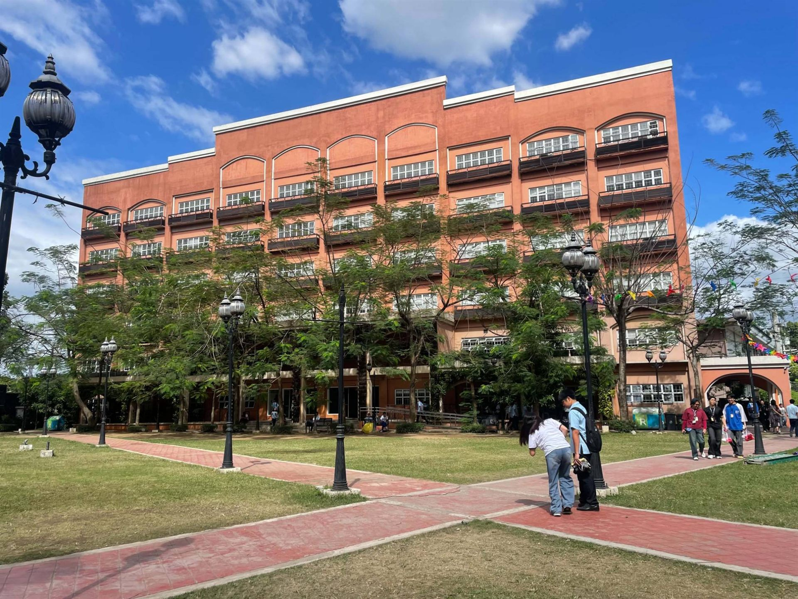

# LBU Online Enrollment System

A web-based enrollment system for **Long Brown University**, built with PHP and MySQL as a school project. Students sign in to enroll in subjects, view their curriculum and keep their profile up to date. Administrators manage accounts, subjects and the campus updates shown on the student home page.



## Features

**Students**
- Home page with campus updates (articles with photos)
- Enroll in subjects for a semester
- Preview enrolled subjects and the curriculum
- View and update the student profile

**Administrators**
- Add, edit, hide and delete campus update articles (with image upload)
- Manage the subject catalog
- Manage user accounts (students and admins)

Students and administrators sign in on the same login page; each is sent to their own area after login.

## Built with

- PHP (mysqli)
- MySQL / MariaDB
- HTML and CSS
- XAMPP for local development

## Getting started

1. Install [XAMPP](https://www.apachefriends.org/) and start **Apache** and **MySQL** from the XAMPP Control Panel.
2. Copy this project into `C:\xampp\htdocs\LBU`, or clone it there:
   ```
   git clone https://github.com/OuroKronoo/LBU.git C:\xampp\htdocs\LBU
   ```
3. Open phpMyAdmin at `http://localhost/phpmyadmin`, create a database named `online_enroll`, and import `online_enroll.sql`.
4. Run `migrate_semester.sql` on the same database (adds the semester column to enrollment records).
5. Open `http://localhost/LBU/` in your browser.

The database connection settings are in `conn.php`, `Admin/includes/conn.php` and `student/includes/conn.php` (default: host `localhost`, user `root`, no password, database `online_enroll`). The articles table is created automatically the first time a page loads.

### Sample accounts

These come from `online_enroll.sql`:

| Role    | Username | Password |
|---------|----------|----------|
| Admin   | `admins` | `admins` |
| Student | `dennis` | `123456` |

## Project structure

```
LBU/
├── index.php              Login page
├── style.css              Login page styles
├── conn.php               Database connection
├── online_enroll.sql      Database schema and sample data
├── migrate_semester.sql   Adds the semester column
├── images/campus/         Campus photos (backgrounds and articles)
├── Admin/                 Administrator pages
│   ├── adminindex.php     Admin home and campus updates
│   ├── subjectreg.php     Subject catalog
│   ├── userreg.php        User accounts
│   └── includes/          Connection, menu, logout, reports
└── student/               Student pages
    ├── studentindex.php   Student home
    ├── enroll.php         Enroll in subjects
    ├── showsubs.php       Enrollment preview / curriculum
    ├── studentprofile.php Student profile
    └── includes/          Connection, menu, logout
```

## Design

The interface follows the "Campus Photo" design described in `LBU-OPTION-C-DESIGN.md`, using photos of the campus for the page backgrounds and article cards.

## Note

This project was made for school purposes only.
